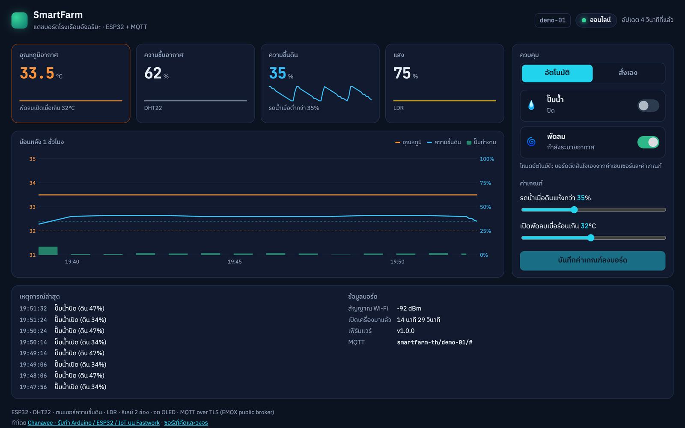
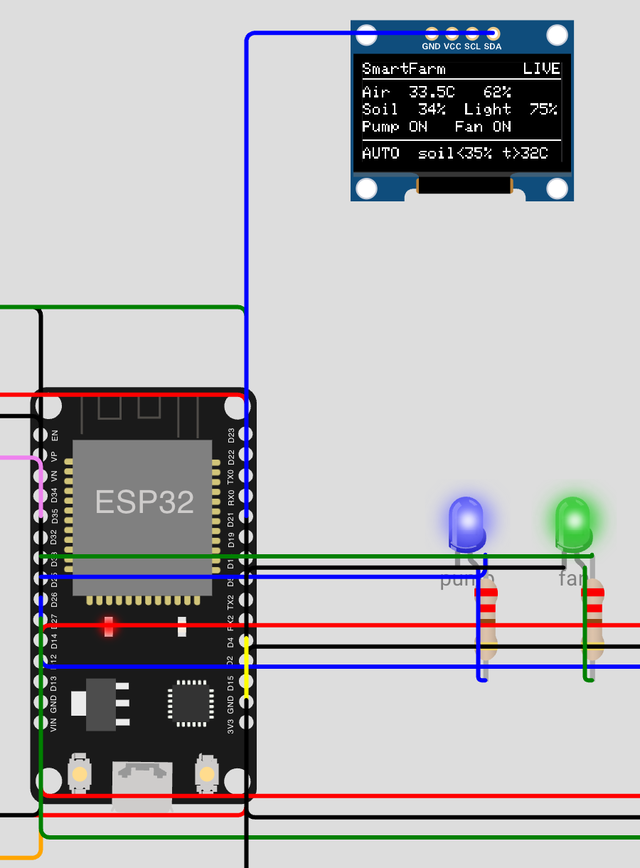
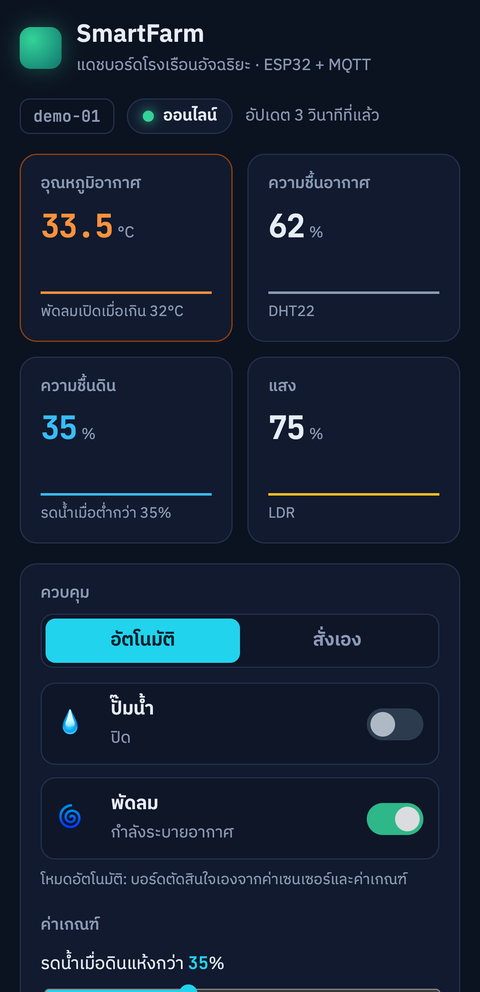

# SmartFarm · โรงเรือนอัจฉริยะ ESP32 + แดชบอร์ด MQTT

**แดชบอร์ดสด:** https://smartfarm-th.vercel.app

ระบบควบคุมโรงเรือนบน ESP32 วัดอุณหภูมิและความชื้นอากาศ (DHT22) ความชื้นดิน และแสง
แล้วเปิดปั๊มรดน้ำกับพัดลมระบายอากาศให้เองตามค่าเกณฑ์ ค่าทั้งหมดขึ้นจอ OLED บนบอร์ด
และส่งผ่าน MQTT แบบเข้ารหัส (TLS) ไปยังหน้าเว็บ ดูค่าแบบเรียลไทม์ ดูกราฟย้อนหลัง และสั่งงานจากมือถือได้



## ทำอะไรได้บ้าง

- **อัตโนมัติ:** ดินแห้งกว่าค่าที่ตั้ง → เปิดปั๊ม แล้วปิดเองเมื่อดินชื้นถึงค่า +10% (hysteresis กันปั๊มติดดับถี่) ร้อนเกินค่าที่ตั้ง → เปิดพัดลม ปิดเมื่อเย็นลง 1.5°C
- **กันปั๊มทำงานแห้ง:** ปั๊มทำงานต่อเนื่องได้ไม่เกิน 1 นาที แล้วพัก 30 วินาทีให้น้ำซึม ใช้ทั้งโหมดอัตโนมัติและโหมดสั่งเอง
- **สั่งงานจากเว็บ:** สลับโหมดอัตโนมัติ / สั่งเอง, เปิดปิดปั๊มและพัดลม, ปรับค่าเกณฑ์ (บอร์ดจำค่าไว้ใน flash แม้ไฟดับ)
- **ปุ่มบนบอร์ด:** กดสลับโหมดได้แม้ไม่มีอินเทอร์เน็ต
- **ทนเน็ตหลุด:** ต่อ Wi-Fi และ MQTT ใหม่เอง (back-off สูงสุด 30 วินาที) และควบคุมต่อได้ระหว่างออฟไลน์
- **สถานะออนไลน์จริง:** ใช้ MQTT Last Will ถ้าบอร์ดดับหรือหลุด เว็บจะเห็นสถานะ "ออฟไลน์" ภายในไม่กี่สิบวินาที
- **กราฟย้อนหลัง 1 ชั่วโมง:** บอร์ดเฉลี่ยค่าทุกนาที เก็บ 60 จุด ส่งเป็น retained message ทำให้เปิดเว็บแล้วเห็นกราฟทันที
- **เวลาจริง:** ซิงก์เวลาจาก NTP (เวลาไทย) ใส่เวลาให้ทุกข้อมูล

<table><tr>
<td width="58%"></td>
<td></td>
</tr></table>

## อุปกรณ์และการต่อวงจร

| อุปกรณ์ | ขา ESP32 | หมายเหตุ |
|---------|----------|----------|
| DHT22 (อุณหภูมิ/ความชื้นอากาศ) | GPIO 15 | VCC 3.3V |
| เซนเซอร์ความชื้นดินแบบ capacitive | GPIO 34 (ADC1) | ตั้งค่า calibration ใน `config.h` |
| โมดูล LDR (แสง) | GPIO 35 (ADC1) | ใช้ขา AO |
| รีเลย์ปั๊มน้ำ | GPIO 26 | รีเลย์แบบ active-low ตั้ง `RELAY_ACTIVE_LOW true` |
| รีเลย์พัดลม | GPIO 27 | |
| LED สถานะปั๊ม / พัดลม | GPIO 25 / 33 | ผ่านตัวต้านทาน 220Ω |
| จอ OLED SSD1306 128×64 (I2C 0x3C) | SDA 21, SCL 22 | |
| ปุ่มสลับโหมด | GPIO 4 → GND | ใช้ pull-up ภายใน |

ใช้ขา ADC1 (32–39) กับเซนเซอร์อนาล็อก เพราะ ADC2 ใช้ไม่ได้ขณะเปิด Wi-Fi

## MQTT

Broker: `broker.emqx.io` (TLS 8883 สำหรับบอร์ด, WebSocket 8084 สำหรับเว็บ) · base topic `smartfarm-th/<DEVICE_ID>`

| Topic | ทิศทาง | ข้อมูล |
|-------|--------|--------|
| `…/state` | บอร์ด → เว็บ ทุก 5 วินาที (retained) | `{"ts":1792326539,"t":33.5,"h":62,"soil":42,"light":75,"pump":false,"fan":true,"pumpResting":false,"mode":"auto","rssi":-71,"uptime":45,"fw":"1.0.0"}` |
| `…/status` | retained + Last Will | `online` / `offline` |
| `…/history` | ทุกนาที (retained) | `[[ts,t,h,soil,light,pump%], …]` 60 จุดล่าสุด |
| `…/config` | retained | `{"mode":"auto","soilMin":35,"tempMax":32}` |
| `…/cmd` | เว็บ → บอร์ด | `{"mode":"manual"}`, `{"pump":true}`, `{"fan":false}`, `{"soilMin":40,"tempMax":30}` |

บอร์ดตรวจใบรับรองของ broker ด้วย root CA (DigiCert Global Root G2 ใน `certs.h`) ไม่ได้ปิดการตรวจ (`setInsecure`)

## ลองรันบอร์ดจริงบน Wokwi

ไม่ต้องมีบอร์ดก็ลองได้ โดยใช้ [Wokwi](https://wokwi.com) ตัวจำลอง ESP32 ที่ต่ออินเทอร์เน็ตได้จริง:

1. เปิด https://wokwi.com/projects/new/esp32
2. วางเนื้อหา [`wokwi/sketch.ino`](wokwi/sketch.ino) แทน sketch เดิม และ [`wokwi/diagram.json`](wokwi/diagram.json) แทน diagram.json
3. เพิ่มไลบรารีตาม [`wokwi/libraries.txt`](wokwi/libraries.txt) (Library Manager › +)
4. กด ▶ รอสักครู่จน Serial Monitor ขึ้น `MQTT connecting … connected`
5. เปิด https://smartfarm-th.vercel.app แล้วสถานะจะเป็น "ออนไลน์" ลองเลื่อนตัวปรับความชื้นดิน คลิก DHT22 เพื่อเปลี่ยนอุณหภูมิ หรือกดปุ่มบนเว็บ

ถ้าบอร์ดออฟไลน์ แดชบอร์ดมีปุ่ม **เปิดอุปกรณ์จำลองในเบราว์เซอร์** ซึ่งรันตรรกะควบคุมชุดเดียวกับเฟิร์มแวร์ ([`dashboard/control.js`](dashboard/control.js) port จาก `control.h`) และส่งข้อมูลผ่าน broker จริง (หน้าเว็บติดป้ายบอกชัดเจนว่าเป็นอุปกรณ์จำลอง)

## Build บนบอร์ดจริง

1. แก้ `firmware/smartfarm/config.h`: ชื่อ/รหัส Wi-Fi, `WIFI_CHANNEL 0`, `DEVICE_ID`, ค่า calibration ของเซนเซอร์ดิน และ broker ส่วนตัวพร้อม user/password
2. ติดตั้ง ESP32 core และไลบรารี: PubSubClient, ArduinoJson 7, DHT sensor library for ESPx, Adafruit SSD1306, Adafruit GFX
3. คอมไพล์และอัปโหลด

```bash
make test                                   # เทสต์ตรรกะควบคุมบนคอมพิวเตอร์ (C++ และ JavaScript)
make compile                                # arduino-cli compile สำหรับ ESP32
make upload PORT=/dev/cu.usbserial-0001     # อัปโหลดลงบอร์ด
make wokwi                                  # สร้าง wokwi/sketch.ino ใหม่หลังแก้เฟิร์มแวร์
```

| ไฟล์ | หน้าที่ |
|------|---------|
| [`firmware/smartfarm/smartfarm.ino`](firmware/smartfarm/smartfarm.ino) | Wi-Fi, MQTT/TLS, เซนเซอร์, OLED, ปุ่ม, ประวัติ, NTP |
| [`firmware/smartfarm/control.h`](firmware/smartfarm/control.h) | ตรรกะควบคุมปั๊ม/พัดลม (C++ ล้วน ไม่มีโค้ด Arduino) |
| [`test/control_test.cpp`](test/control_test.cpp) | เทสต์ hysteresis, ระบบพักปั๊ม, โหมดสั่งเอง, เซนเซอร์เสีย และ `millis()` วนรอบ 49 วัน |
| [`test/control.test.mjs`](test/control.test.mjs) | เทสต์ชุดเดียวกันกับตรรกะเวอร์ชัน JavaScript ที่อุปกรณ์จำลองใช้ ให้ทำงานตรงกับเฟิร์มแวร์ |
| [`dashboard/`](dashboard/) | เว็บแดชบอร์ด (HTML/CSS/JS ล้วน + mqtt.js) และอุปกรณ์จำลอง |

## ข้อควรรู้

- `broker.emqx.io` เป็น broker สาธารณะ ใครก็อ่านหรือส่งคำสั่งได้ถ้ารู้ topic ใช้สำหรับเดโมเท่านั้น งานจริงควรใช้ broker ส่วนตัว (EMQX Cloud, HiveMQ Cloud, Mosquitto) พร้อม user/password และ ACL
- ภาพในหน้านี้มาจากการรันเฟิร์มแวร์ตัวเดียวกันบน Wokwi ซึ่งจำลองฮาร์ดแวร์ ESP32 ทั้งชิป และต่อเน็ตจริง ส่วนเซนเซอร์ดินใน Wokwi เป็นตัวปรับแบบเลื่อน
- ปั๊มจริงควรมีฟิวส์และแหล่งไฟแยกจากบอร์ด อย่าจ่ายไฟปั๊มผ่านขา 5V ของ ESP32

---

ทำโดย Chanavee (นักศึกษาวิศวกรรมคอมพิวเตอร์ มจธ.) · รับทำ Arduino / ESP32 / IoT ผ่าน [Fastwork](https://fastwork.co/user/chasvitf) · โค้ดเผยแพร่ภายใต้ [MIT](LICENSE)

**English:** SmartFarm is an ESP32 greenhouse controller (DHT22, capacitive soil sensor, LDR, two relays, SSD1306 OLED, mode button) with hysteresis control and a pump run-time limit, talking MQTT over TLS with Last Will, retained state and a one-hour history. The static web dashboard shows live values, a history chart and controls, and includes an in-browser simulator that runs a JavaScript port of the same control logic. The control logic is unit-tested on the host; the firmware was exercised end to end on the Wokwi ESP32 simulator.
